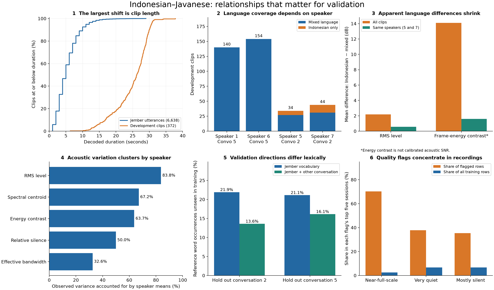
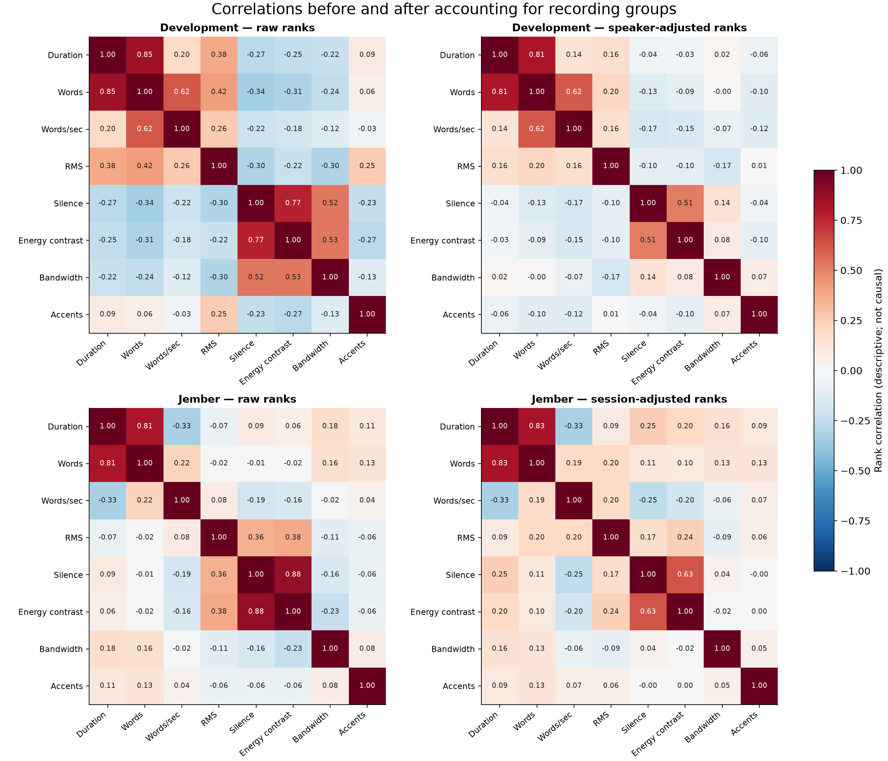

# Relationships within the Indonesian–Javanese data

This extends the [integrity and preparation audit](data-audit.md) with relationships among audio, text, language, speakers, conversations, and training recordings. It covers every development clip and all 6,638 training rows with positive timestamps, using the full local audio measurements. It does not establish that the transcriptions are correct or measure model errors.



## 1. Speaker, conversation, and language cannot be treated as independent factors

Development has this exact structure:

| Conversation | Speaker | Mixed-language clips | Indonesian-only clips |
| --- | --- | ---: | ---: |
| 5 | 1 | 140 | 0 |
| 5 | 6 | 154 | 0 |
| 2 | 5 | 27 | 7 |
| 2 | 7 | 31 | 13 |

Every speaker belongs to one conversation. The regression design with speaker, conversation, and language indicators has six columns but rank five: speaker and conversation effects cannot be independently identified from this sample. There is also no Indonesian-only support for two speakers and no Javanese-only support at all.

This is not a technical footnote. An aggregate language comparison uses different mixes of speakers and recording conditions. Comparing Indonesian-only and mixed clips within the two speakers who provide both labels changes the result:

| Mean Indonesian-minus-mixed difference | All development clips | Within the same speakers, weighted by Indonesian clip counts |
| --- | ---: | ---: |
| RMS level | +2.18 dB | +0.58 dB |
| Frame-energy contrast | +14.10 dB | +1.60 dB |
| Relative silence | +8.51 percentage points | −0.42 percentage points |
| Effective bandwidth | +1,106 Hz | −90 Hz |

The silence and bandwidth contrasts reverse sign and become small after restricting the comparison. These descriptive results do not show that language causes a change in sound quality. They show why a global language comparison would be misleading.

Within-speaker comparisons still have only 7 and 13 Indonesian-only clips. Speaker 5 and speaker 7 sometimes show different directions, so the adjusted mean should not be treated as a universal language effect.

## 2. Much of the acoustic variation is associated with speakers or recordings

The share of observed development variance accounted for by speaker group means is:

| Feature | Variance associated with speaker grouping |
| --- | ---: |
| RMS level | 83.8% |
| Spectral centroid | 67.2% |
| Frame-energy contrast | 63.7% |
| Relative silence | 50.0% |
| Effective bandwidth | 32.6% |

For example, speakers 1 and 6 are in the same conversation, but their mean RMS levels are −20.81 and −25.95 dBFS. Speaker labels can also stand in for microphone, gain, environment, or conversational behavior; this analysis does not separate those explanations or identify the people.

Training shows similar grouping. Session means account for 83.8% of RMS variation, 69.5% of spectral-centroid variation, and 58.3% of bandwidth variation. By comparison, the 44.1/48 kHz distinction accounts for only about 1.6% of RMS variation and 0.6% of bandwidth variation. Resampling is necessary, but native sample rate alone does not summarize the recording differences.

Jember has 208 session IDs but no verified speaker IDs. The ten largest sessions contain 22.3% of its scoring words. Session size and recording conditions should therefore be tracked during training sampling and validation, while acknowledging that session-held-out is not verified speaker-held-out.

## 3. The duration mismatch is stronger than the speaking-rate mismatch

| Decoded duration | Training segments | Development clips |
| --- | ---: | ---: |
| Under 2 seconds | 388 | 0 |
| 2 to under 6 seconds | 3,523 | 0 |
| 6 to under 12 seconds | 2,386 | 5 |
| 12 to under 20 seconds | 318 | 62 |
| 20 to under 30 seconds | **23** | **268** |
| At least 30 seconds | 0 | 37 |

Only 0.35% of measured training segments occupy the 20–30-second range that contains 72.0% of development clips. About 91.9% of development durations exceed the training 99th percentile of 16 seconds.

In contrast, median word rates are 2.00 words/second in training and 1.86 in development; all development rates are within the training 1st–99th-percentile range. The long development references are primarily associated with longer clips, not an extreme speaking rate. Duration and word count have rank correlations of 0.81 in training and 0.85 in development.

Audio/text proportions still deserve local inspection: word rate is a ratio of transcript length and duration, not a measurement of alignment correctness. All 6,679 original training rows have integer-second endpoints, which provides coarse timing for short utterances. A one-second boundary discrepancy is proportionally large for a one- or five-second segment.

Duration-stratified comparisons were also calculated. They cover 335 development clips but exclude the 37 clips with no training support above 30 seconds. The longest shared bin has only 23 training examples, so reweighting it to represent 268 development examples is unstable. The audit records these comparisons but does not treat them as a reliable correction for the domain gap.

Implication: evaluate longer training windows assembled from adjacent, validated intervals in the same recording. Do not concatenate unrelated sessions merely to match a duration histogram. A model evaluation is needed to establish whether longer windows help.

## 4. Vocabulary relationships make the two validation directions unequal

These are official-normalizer token coverage measurements, not WER:

| Held-out development conversation | Unseen words using Jember alone | Using the other conversation alone | Using Jember plus the other conversation |
| --- | ---: | ---: | ---: |
| 2: 78 clips, 3,556 words | 21.91% | 19.74% | 13.58% |
| 5: 294 clips, 13,929 words | 21.13% | **35.30%** | 16.14% |

The larger conversation supplies substantially more vocabulary when used as training data. Conversely, training on the smaller conversation leaves much more of conversation 5's vocabulary unseen. Both holdout directions need separate reporting. Pooling their errors would also assign 79.66% of reference-word weight to conversation 5.

Against Jember, Indonesian-only development clips have 24.16% unseen scoring words versus 21.14% for mixed clips. Across speakers the unseen-word rate ranges from 18.43% to 23.53%. These differences are associated with speaker, topic, language mix, and transcription convention; they are not isolated language effects.

The full output also includes token/type coverage and Jensen–Shannon divergence for each language, conversation, and speaker, using exact scoring tokens, case folding, and accent-plus-case folding. Reference tokens and transcripts are not copied into those outputs.

Within Jember, the median session has 8.75% of its word occurrences absent from the other 207 sessions; the 95th-percentile session has 15.46%. These figures describe session-specific vocabulary and annotation, not topic labels or model errors.

## 5. Quality issues cluster, and blanket filtering loses useful coverage

The five sessions with the most clipping flags—197, 198, 196, 195, and 194—contain **70.2% of clipping-flagged segments but only 2.53% of training rows**. Review these recordings together instead of treating each segment as an unrelated defect. Decoded MP3 overshoot remains a possible explanation for some flags.

Very quiet audio is more dispersed: 80 sessions are affected, and the top five contain 37.8% of quiet flags. Mostly-silent flags occur across 61 sessions; their top five contain 35.4% of those flags.

Simulating removal of every segment with any of the five acoustic/token-rate flags would:

- Remove **1,425 of 6,638 positive-timestamp rows (21.47%)**.
- Remove **17.87% of their scoring words**.
- Remove all training occurrences of **967 distinct scoring-word types**.
- Leave **247 additional development word occurrences** without training vocabulary coverage.
- Increase development token OOV from **21.29% to 22.70%**.

This simulation does not say that all flagged audio is valuable, nor that filtering increases model WER. It quantifies what a broad deletion rule would remove. It is separate from the 46 timestamp quarantine candidates in the original audit; no data was actually deleted or filtered.

Per-flag removal scenarios and session-level quality summaries are saved for targeted review.

## 6. Several apparent correlations are mostly between recording groups



Fourteen features were examined, giving 91 feature pairs in each dataset. The adjusted statistic correlates pooled feature ranks after subtracting each speaker's or session's mean rank. It is descriptive adjustment, not causal inference.

Examples:

| Relationship | Raw rank correlation | After group adjustment |
| --- | ---: | ---: |
| Development energy contrast ↔ bandwidth | +0.531 | +0.084, adjusted for speaker |
| Development silence ↔ bandwidth | +0.524 | +0.144, adjusted for speaker |
| Training RMS ↔ spectral centroid | −0.371 | +0.087, adjusted for session |
| Training peak level ↔ spectral centroid | −0.193 | +0.243, adjusted for session |

A rule learned from the raw correlation could therefore behave differently within a recording or on a new recording. This is another reason to avoid random clip splits and indiscriminate acoustic transformations.

Some relationships are partly built into the feature definitions. Word rate divides word count by duration. The energy-contrast estimate and relative-silence ratio both depend on frame energy; their strong positive correlation does not independently prove better signal quality. Absolute SNR was not measured.

Relative position within each training recording was screened against all 14 features. After session adjustment, the largest absolute rank correlation is 0.061. No strong monotonic within-session drift was detected by this screen. Local changes, nonlinear patterns, and speaker turns are not ruled out. Development chronology cannot be reconstructed from hashed clip filenames alone.

The train/development shift calculations were repeated without the five training segments extending beyond available audio. The largest change in signed Cliff's delta was less than 0.001, so these five defects do not explain the broad measured distribution differences.

## Coverage and limits

| Question | Status |
| --- | --- |
| Archive, file, schema, timestamp, duration, decoding integrity | Complete automated pass over both archives |
| Native waveform quality, text conventions, duplicate screens | Complete implemented checks; heuristic limitations in the primary report |
| Speaker/conversation/language dependence | Quantified, including missing combinations and non-identifiable effects |
| Audio/text relationships and grouped correlations | 14 features; 91 pairs per dataset; raw and group-adjusted |
| Train/development distribution shift | Descriptive KS D, signed Cliff's delta, quantiles, and limited duration-stratified comparisons |
| Group vocabulary coverage and validation asymmetry | Quantified without exporting transcript strings |
| Session concentration, temporal patterns, and filtering consequences | Quantified; no filtering applied |
| Correctness of every transcript and timestamp against heard speech | **Not established: requires local listening and appropriate language expertise** |
| Actual word-level language switches and switch boundaries | **Not measured: clip-level labels are insufficient** |
| Speaker identity overlap between Jember and development | **Unverified: Jember lacks speaker labels** |
| Model errors versus these characteristics | **Not measured: requires held-out predictions** |
| Hidden-test composition, labels, or leakage | **Not accessible locally** |

This is now a broad automated data and relationship audit, not a claim to have verified everything about the speech. The remaining items should stay explicit rather than being inferred from correlations.

## Reproduction and evidence

From the Indonesian workspace:

```bash
../.venv/bin/python scripts/audit_relationships.py
uv run --no-project --with numpy==2.5.2 --with matplotlib==3.11.1 python scripts/plot_relationships.py
PYTHONPATH=src ../.venv/bin/python -m unittest tests.test_audit_relationships -v
```

The primary audio audit must already have run. No audio decoding or model inference is repeated by the relationship analysis. Seven new tests cover tied ranks, known distribution distances, nested-factor identifiability, between-group confounding, partial effects, and divergence bounds. Both generated figures were visually inspected for labels and layout.

- [Relationship statistics](../reports/relationships.json), including hashes of the waveform measurement inputs.
- [Private session-level relationships](../reports/private/session_relationships.json).
- [Overview PNG](../reports/figures/data_relationships.png) and [SVG](../reports/figures/data_relationships.svg).
- [Correlation PNG](../reports/figures/relationship_correlations.png) and [SVG](../reports/figures/relationship_correlations.svg).

There are no IID clip-level significance claims or model-performance claims in this analysis. The two development conversations are too limited to treat hundreds of clips as hundreds of independent environments.
